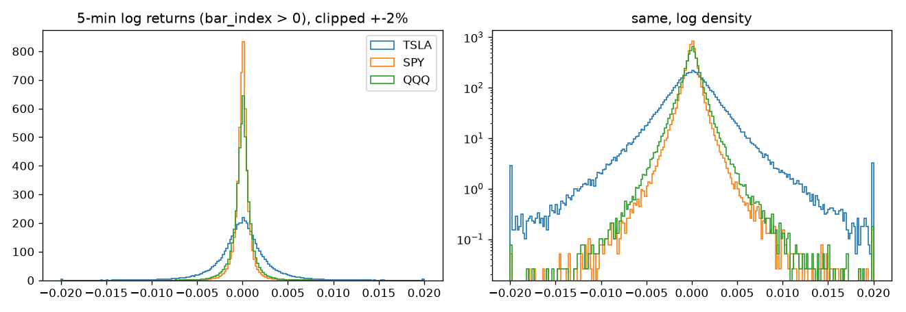

# Phase 1 data-quality report (data v2)

Source: Alpaca SIP 1-minute bars, aggregated to 5-minute regular-session bars (timestamps = bar end, America/New_York). SPY/QQQ back-adjusted for cash dividends (Alpha Vantage DIVIDENDS). Development period only: holdout (>= 2026-01-01) was not copied or loaded.

## Date range

- **TSLA**: 2016-01-04 09:35 -> 2025-12-31 16:00, 195,180 bars, 2,512 sessions
- **SPY**: 2016-01-04 09:35 -> 2025-12-31 16:00, 195,258 bars, 2,513 sessions
- **QQQ**: 2016-01-04 09:35 -> 2025-12-31 16:00, 195,102 bars, 2,511 sessions

## Bars and sessions per year

| year | QQQ | SPY | TSLA |
|---|---|---|---|
| 2016 | 19542 | 19620 | 19542 |
| 2017 | 19506 | 19506 | 19506 |
| 2018 | 19314 | 19470 | 19392 |
| 2019 | 19548 | 19470 | 19548 |
| 2020 | 19662 | 19662 | 19662 |
| 2021 | 19620 | 19620 | 19620 |
| 2022 | 19542 | 19542 | 19542 |
| 2023 | 19428 | 19428 | 19428 |
| 2024 | 19548 | 19548 | 19548 |
| 2025 | 19392 | 19392 | 19392 |

| year | sessions | half_days |
|---|---|---|
| 2016 | 251 | 1 |
| 2017 | 251 | 2 |
| 2018 | 250 | 3 |
| 2019 | 252 | 3 |
| 2020 | 253 | 2 |
| 2021 | 252 | 1 |
| 2022 | 251 | 1 |
| 2023 | 250 | 2 |
| 2024 | 252 | 3 |
| 2025 | 250 | 3 |

Full sessions have 78 bars; NYSE half-days (13:00 close) have 42.

## Missing bars

| symbol | calendar_sessions | sessions_kept | sessions_dropped(>5% missing) | dropped_dates | missing_bars_before_drop | missing_bars_kept(ffilled) | bars_with_<5_minutes |
|---|---|---|---|---|---|---|---|
| TSLA | 2514 | 2512 | 2 | 2016-02-22 (10%), 2018-08-07 (24%) | 36 | 9 | 392 |
| SPY | 2514 | 2513 | 1 | 2019-08-12 (6%) | 14 | 9 | 20 |
| QQQ | 2514 | 2511 | 3 | 2016-02-22 (10%), 2018-05-02 (99%), 2018-05-03 (99%) | 171 | 9 | 16 |

Missing 5-minute bars are forward-filled (O=H=L=C=previous close, volume 0, `missing=True`). Sessions with > 5% missing bars are dropped. 2016-02-22 is a gap in the vendor files (TSLA and QQQ). 2018-05-02/03 are missing from the split-adjusted downloads (QQQ, and TSLA in data v1) but present in the TSLA RAW download used by data v2. **2018-08-07 (TSLA) was a real trading halt** ("funding secured" tweet, halted ~14:08-15:45 ET); the session was dropped under the 5% rule, so the next session's bar-0 return covers the gap from that day's close.

## Bad ticks (flagged, not deleted)

Rule: |log return| > 15 x trailing median |r| (intraday: previous 390 bars; bar 0: previous 20 opening bars). `bad_range`: same rule on ln(H/L).

| symbol | bad_tick_flags | of_which_bar0(gap) | spike_and_revert(next bar reverses >50%) | bad_range_flags | max_abs_r |
|---|---|---|---|---|---|
| TSLA | 76 | 3 | 8 | 5 | 0.1712 |
| SPY | 69 | 2 | 13 | 12 | 0.1175 |
| QQQ | 77 | 1 | 9 | 4 | 0.1074 |

Largest flagged bars (inspection):

| symbol | timestamp | bar_index | r | next_r | volume |
|---|---|---|---|---|---|
| TSLA | 2019-10-24 09:35 | 0 | 0.1603 | -0.01741 | 6.074e+07 |
| TSLA | 2019-07-25 09:35 | 0 | -0.1383 | -0.009024 | 3.102e+07 |
| TSLA | 2024-11-06 09:35 | 0 | 0.1352 | -0.0001723 | 1.405e+07 |
| TSLA | 2020-02-04 15:55 | 76 | -0.08761 | 0.0155 | 3.139e+07 |
| TSLA | 2025-04-07 10:15 | 8 | 0.0701 | -0.01734 | 7.15e+06 |
| SPY | 2020-03-09 09:35 | 0 | -0.07348 | 0 | 5.795e+06 |
| SPY | 2025-04-07 10:15 | 8 | 0.03811 | 0.001498 | 1.329e+07 |
| SPY | 2016-06-24 09:35 | 0 | -0.03029 | 0.002788 | 1.26e+07 |
| SPY | 2025-04-07 10:25 | 10 | -0.02926 | -0.003046 | 1.025e+07 |
| SPY | 2022-09-21 14:05 | 54 | -0.01636 | 0.005237 | 5.93e+06 |
| QQQ | 2025-04-07 10:15 | 8 | 0.03977 | 0.00113 | 8.807e+06 |
| QQQ | 2025-04-07 10:25 | 10 | -0.02951 | -0.005402 | 6.934e+06 |
| QQQ | 2022-09-21 14:05 | 54 | -0.02015 | 0.006041 | 4.574e+06 |
| QQQ | 2018-12-19 14:05 | 54 | -0.0181 | 0.002029 | 2.801e+06 |
| QQQ | 2024-07-17 09:35 | 0 | -0.01773 | 0.0001333 | 2.705e+06 |

## Split-adjustment check (TSLA)

| split_date | factor | prev_close | open | bar0_log_return | unadjusted_would_be | max_abs_r_+-1_session |
|---|---|---|---|---|---|---|
| 2020-08-31 | 5:1 | 147.6 | 148.2 | 0.009635 | -1.609 | 0.02284 |
| 2022-08-25 | 3:1 | 297.2 | 302.4 | 0.004312 | -1.099 | 0.009948 |

No -80% / -67% jump: prices are correctly split-adjusted.

## Dividend adjustment check (SPY, QQQ)

| symbol | n_ex_dates | mean_dividend_yield | mean_exdate_gap_after_adj | mean_exdate_gap_before_adj(est) | mean_gap_all_days |
|---|---|---|---|---|---|
| SPY | 40 | 0.004126 | -0.0003374 | -0.004472 | 0.0004035 |
| QQQ | 41 | 0.001801 | -0.0003464 | -0.002149 | 0.0005286 |

Before adjustment the ex-date gap averaged roughly minus the dividend yield, which shows the source is not dividend-adjusted; after adjustment it is close to the all-day average.

## TSLA earnings sessions

40 reports in the dev period, all `post-market` -> reaction session = next trading day (none had a missing report time). First 2016-02-10, last 2025-10-22.

## Return distribution

| symbol | n | std | skew | excess_kurtosis | share_exact_zero |
|---|---|---|---|---|---|
| TSLA | 195179 | 0.004114 | -0.2753 | 157.5 | 0.003105 |
| SPY | 195257 | 0.00127 | -5.412 | 631.1 | 0.01424 |
| QQQ | 195101 | 0.001541 | -2.349 | 249.5 | 0.01641 |
